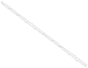
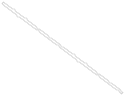

# A 352-square polyomino that folds into four different boxes

Folds into four boxes: **1×2×58**, **2×2×43**, **2×7×18**, **2×10×13**

Two polyominoes of **352 unit squares**, net A and net B. Each folds, along grid lines only, onto the surfaces of these
four boxes, and onto no other box of surface area 352. They are the smallest four-box nets found so far in this work,
**not claimed to be minimal**. Not peer reviewed; corrections are welcome as issues.

Net A:



Net B:



3-D viewer: [`viewer/index.html`](viewer/index.html). Download it and open it in a browser (one file, works offline).
It folds net A or net B into each of the four boxes in turn. All fold lines turn together; this is not a physical
folding sequence.

## What is new

This work builds on the four-box net of 532 squares by Reed Silverstein and Conner Silverstein [1] and extends their
construction.

**From [1]:**

- A four-box net of 532 squares.
- The construction: a long strip whose two edges are each glued to themselves by reflections, so that one strip folds
  into four flat "pillowcases".
- Notches and tabs that turn the corners of a pillowcase into box corners.
- Turning the strip, in direction (2, 1), onto the square grid.
- The `CheckNet.java` driver for the checker [2], and the folding-data format.

**New here:**

- Two four-box nets of 352 squares, net A and net B.
- The construction for any strip direction (p, q), with a formula for the area and the four boxes.
- A rule of the construction for notches and tabs (`docs/construction.md`, section 5): they fit together only when
  the number m is odd. That each edge carries at most two reflections, so that one strip gives at most four boxes,
  was stated by Silverstein and Silverstein in [4]; for notches and tabs it is checked here by computation (all edge
  lengths up to 120), not proved.
- Two methods for the corners: a search of notch and tab shapes on the square grid (net A), and an exact integer
  program (net B).
- A series of four-box nets given by the formula, which contains the 532 net of [1]; 20 members checked with the
  checker of [2].

## Check it yourself

```
python3 verify/verify_folds.py data/net-352-a-cells.txt
python3 verify/verify_folds.py data/net-352-b-cells.txt
```

Python 3 standard library only. The script tests all ten boxes of surface area 352 and prints which ones the net folds
into: for both nets, exactly the four boxes above. The same result was obtained with `ValidNetSolutionChecker` [2], run
through `verify/CheckNet.java`.

## Construction

A long W × H strip has its short ends joined. Its bottom edge is glued to itself by a reflection x ↔ a − x and its top
edge by x ↔ b − x (mod W). This gives a flat doubled rectangle, a "pillowcase" (that one strip folds into many such
flat boxes was shown in [3]). With two possible gluings on each edge, one strip has four different pillowcases. Stepped
notches and matching tabs turn the flat corners of a pillowcase A × B into box corners, giving a box
2 × (A − 2) × (B − 2) of surface area 2AB − 8. The strip is then rotated so that the box edges follow the square grid,
and resampled onto unit squares.

**Any direction (p, q).** In [1] the strip runs in direction (2, 1). Here it runs in direction (p, q), with p, q coprime and p + q odd, and has height
H = c·p·q. With m = k·l, gcd(k, l) = 1, the four pillowcases are A × B = c·p·k × c·q·l, so

> **area = 2c²·p·q·m − 8, boxes 2 × (c·p·k − 2) × (c·q·l − 2) for the four ordered factorisations m = k·l.**

Net A and net B: (p, q) = (4, 3), c = 1, m = 15, strip 750 × 12.

| k · l | Pillowcase | Box |
|---|---|---|
| 1 · 15 | 4×45 | 2×2×43 |
| 3 · 5 | 12×15 | 2×10×13 |
| 5 · 3 | 20×9 | 2×7×18 |
| 15 · 1 | 60×3 | 1×2×58 |

The 532 net of [1] has (p, q) = (2, 1), c = 3, m = 15. Details, including why the notches and tabs fit together only
when m is odd: [`docs/construction.md`](docs/construction.md). The search
programs are in [multi-box-nets](https://github.com/ro-novikov/multi-box-nets).

## Net A and net B

Both nets come from the same strip with the same gluings and differ only at the corners. Each removes 20 squares of the
strip and adds 12, never the same square; neither is a rotation or reflection of the other. Net B uses only dominoes
for its notches and tabs and was found by the integer program; net A uses pieces of one or two squares and was found by
the grid search. Both corner methods, run over all placements of this strip, give only these two nets; other 352-square
nets with these boxes are not excluded. Details: [`docs/construction.md`](docs/construction.md), section 4.

## Not minimal

Within the construction no smaller area was found: four boxes need an odd m with two distinct prime factors, so
m ≥ 15, and the smallest c²·p·q that gives four boxes is 12, at (p, q) = (4, 3), c = 1: area 2 · 12 · 15 − 8 = 352. In
general the minimum is open; smaller four-box nets built in some other way are not excluded.

<!-- series:start (generated by common/build_four_box.py) -->
## The series

Net A and net B are the first members of a series of four-box nets given by the formula above; the 532 net of [1] is
another member (row ¹). The table shows 20 members: the 20 parameter sets of smallest area for which a net was
built. Each of these nets was checked with `ValidNetSolutionChecker` [2] against every box of its surface area, and
folds into exactly the four boxes listed.

This is not a complete list. The nets were built with one corner search, which gave no net for 7 other parameter
sets in the same range; whether those have a net is open. All parameter sets, the nets and
the programs are in [multi-box-nets](https://github.com/ro-novikov/multi-box-nets). Machine-readable:
[`data/family.csv`](data/family.csv).

| Area | Boxes | (p, q) | c | m |
|---:|---|---|---:|---:|
| 352 | 1×2×58, 2×2×43, 2×7×18, 2×10×13 | (4, 3) | 1 | 15 |
| 496 | 1×2×82, 2×2×61, 2×7×26, 2×10×19 | (4, 3) | 1 | 21 |
| 532 ¹ | 1×2×88, 2×4×43, 2×7×28, 2×13×16 | (2, 1) | 3 | 15 |
| 592 | 2×2×73, 2×3×58, 2×10×23, 2×13×18 | (5, 4) | 1 | 15 |
| 712 | 2×2×88, 2×4×58, 2×10×28, 2×16×18 | (3, 2) | 2 | 15 |
| 712 | 1×2×118, 2×6×43, 2×7×38, 2×13×22 | (8, 3) | 1 | 15 |
| 748 | 1×2×124, 2×4×61, 2×7×40, 2×16×19 | (2, 1) | 3 | 21 |
| 832 | 2×2×103, 2×3×82, 2×10×33, 2×13×26 | (5, 4) | 1 | 21 |
| 832 | 2×2×103, 2×5×58, 2×10×33, 2×18×19 | (7, 4) | 1 | 15 |
| 892 | 2×3×88, 2×4×73, 2×13×28, 2×16×23 | (6, 5) | 1 | 15 |
| 952 | 2×2×118, 2×6×58, 2×10×38, 2×18×22 | (2, 1) | 4 | 15 |
| 1000 | 2×2×124, 2×4×82, 2×10×40, 2×16×26 | (3, 2) | 2 | 21 |
| 1000 | 1×2×166, 2×6×61, 2×7×54, 2×19×22 | (8, 3) | 1 | 21 |
| 1072 | 1×2×178, 2×2×133, 2×13×34, 2×18×25 | (4, 3) | 1 | 45 |
| 1072 | 2×2×133, 2×7×58, 2×10×43, 2×18×25 | (9, 4) | 1 | 15 |
| 1168 | 2×2×145, 2×5×82, 2×10×47, 2×19×26 | (7, 4) | 1 | 21 |
| 1192 | 2×2×148, 2×8×58, 2×10×48, 2×18×28 | (5, 2) | 2 | 15 |
| 1192 | 2×3×118, 2×6×73, 2×13×38, 2×22×23 | (8, 5) | 1 | 15 |
| 1252 | 2×3×124, 2×4×103, 2×13×40, 2×16×33 | (6, 5) | 1 | 21 |
| 1252 | 2×4×103, 2×5×88, 2×16×33, 2×19×28 | (7, 6) | 1 | 15 |

¹ The parameters of the 532 net of [1]. The net checked here for this row is a different polyomino with the same four
boxes.
<!-- series:end -->

## Data

`data/`: the two nets (cells, cut outlines, folding data) and the series table. Formats:
[`docs/FORMAT.md`](docs/FORMAT.md).

## References

1. R. Silverstein, C. Silverstein, [four-box-net-532](https://github.com/Sprite143/four-box-net-532), 2026: a
   532-square net that folds into four boxes, and how it was found
   ([how-we-found-the-four-box-net.md](https://github.com/Sprite143/four-box-net-532/blob/main/docs/how-we-found-the-four-box-net.md)).
2. [hidny/CuboidSimplePhaseNetSearch](https://github.com/hidny/CuboidSimplePhaseNetSearch): `ValidNetSolutionChecker`.
3. Z. Abel, E. Demaine, M. Demaine, H. Matsui, G. Rote, R. Uehara, *Common developments of several different orthogonal
   boxes*, CCCG 2011, pp. 77–82: among other results, a long strip folds into any number of flat boxes (doubly covered
   rectangles).
4. C. Silverstein, R. Silverstein, [five-box-net-2128](https://github.com/Sprite143/five-box-net-2128), 2026: a polyomino
   that folds into five different boxes.

Related work:

- T. Shirakawa, R. Uehara, *Common developments of three different orthogonal boxes*, CCCG 2012, pp. 17–21: the first
  polygon that folds into three boxes of positive volume (area 1792), and an infinite family. Journal version:
  *Common developments of three incongruent orthogonal boxes*, Int. J. Comput. Geom. Appl. 23(1) (2013) 65–71.
- L. Qian, E. Wang, B. Subercaseaux, M. J. H. Heule, *Unfolding boxes with local constraints*, 2025,
  [arXiv:2506.01079](https://arxiv.org/abs/2506.01079).
- Demaine, Diomidova, Jacobus, Kryger, Parker, Tardibuono, Uehara, Zhang, *Polyomino nets covering three different
  boxes of area 106 and related results*, 2026, [arXiv:2608.19910](https://arxiv.org/abs/2608.19910).

## Credits

The search and the write-up were done with Claude Opus 5.5 (Anthropic).

## License

Code (`*.py`, `*.java`, `viewer/index.html`) is released under the MIT License; data, figures and write-ups under
CC BY 4.0 (see [`LICENSE`](LICENSE)). `verify/CheckNet.java` is from [1] (MIT).

## Citing

Rodion Novikov, *A 352-square polyomino that folds into four different boxes*, 2026,
https://github.com/ro-novikov/four-box-net-352
